# LB2_project_Group_7

## Data collection
Data were retrieved from UniProt with a specific query (first filtering) and then polished the .tsv datasets from entries whose cleavage was absent or unknown (second filtering). The final collection of data consisted of these numbers of entries:<br>

| Dataset  | Entries    | %      |
|----------|-----------:|-------:|
| (+) Positive | **2,956**  | 12.4%  |
| (-) Negative | **20,974** | 87.6%  |

Code and results are in [`0.1_data_collection/`](0.1_data_collection/).

## Data preparation
Results in .fasta format were aligned and clustered with mmseqs, and one representative of each cluster was copied in a new .tsv file and labelled with "0" (negatives) or "1" (positives).<br>
The representatives were shuffled and then split between the training (80% of positives and 80% of negatives) and the benchmark dataset (remaining 20% of both).<br>

The previous labelling was useful to split the training dataset in 5 subsets, each with 20% of both positives and negatives (in this way, the ratio will be constant among all the subsets).<br>

### Training sets

| Subset    | (+) Positives | (-) Negatives | Total      | % of dataset |
|-----------|----------:|----------:|-----------:|-------------:|
| sub_1     | 177       | 1454      | 1631       | 16.0%        |
| sub_2     | 176       | 1453      | 1629       | 16.0%        |
| sub_3     | 177       | 1453      | 1630       | 16.0%        |
| sub_4     | 176       | 1453      | 1629       | 16.0%        |
| sub_5     | 176       | 1453      | 1629       | 16.0%        |
| bench     | 220       | 1816      | 2036       | 20.0%        |
| **Total** | **1102**  | **9082**  | **10184**  |              |

Code and results are in [`0.2_data_pre_processing/`](0.2_data_pre_processing/).

## Data visualization

### Protein length distribution
| Training | Benchmark |
|---|---|
| 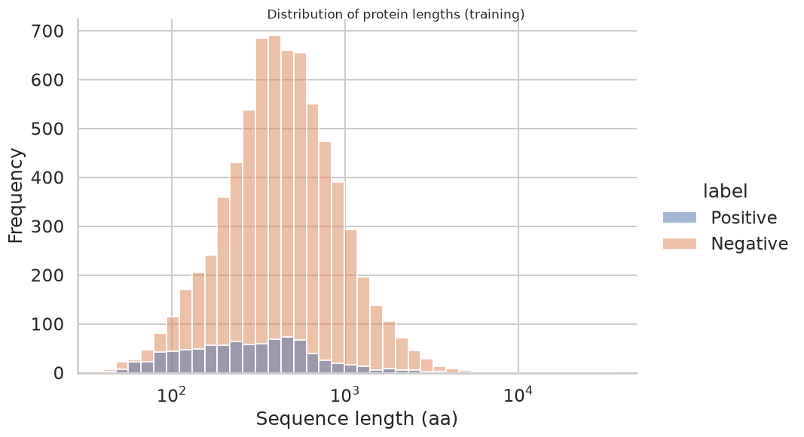 | 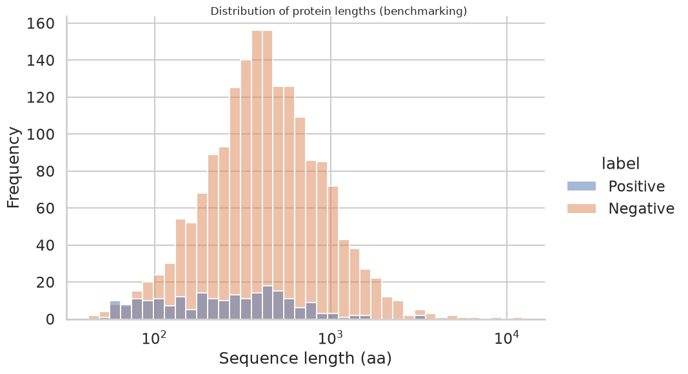 |

### Signal peptide length distribution ~ positives
| Training | Benchmark |
|---|---|
| 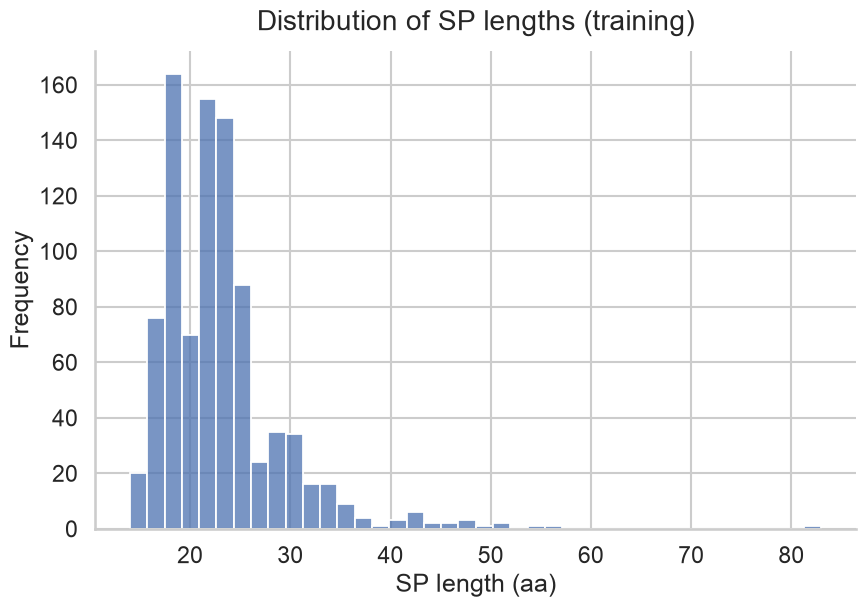 | 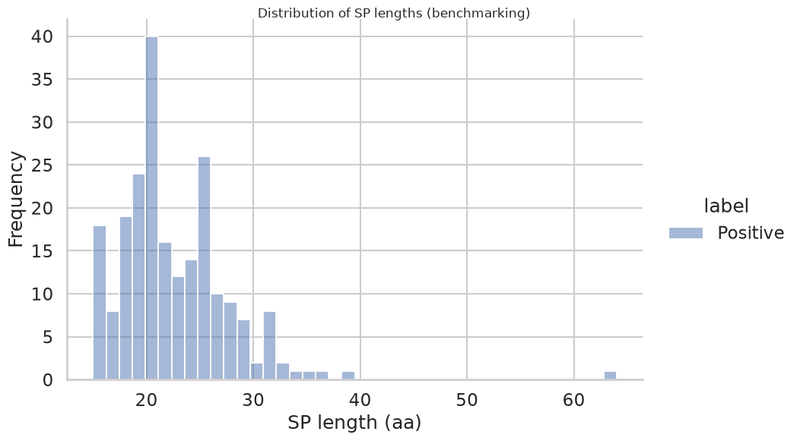 |

### Amino-acid composition (SP vs Background)
| Training | Benchmark |
|---|---|
| 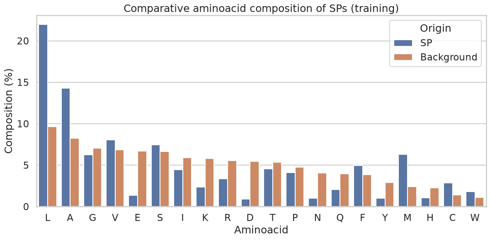 | 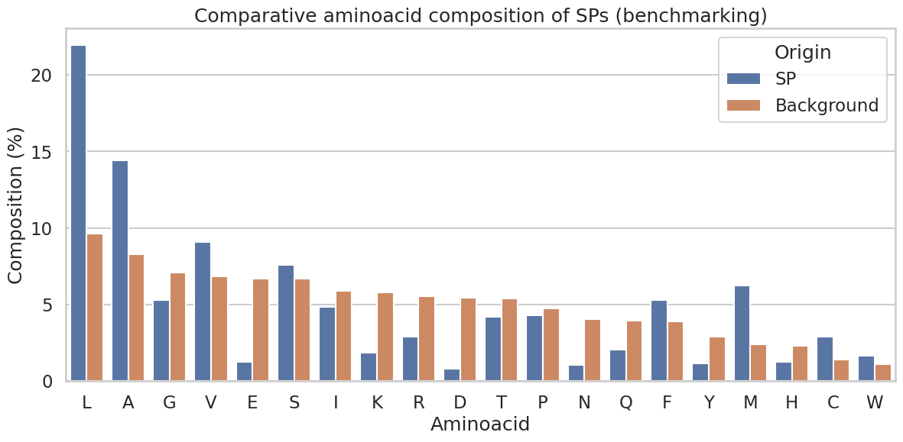 |

### Taxonomic classification ~ kingdom
| Training (positives) | Training (negatives) |
|---|---|
| 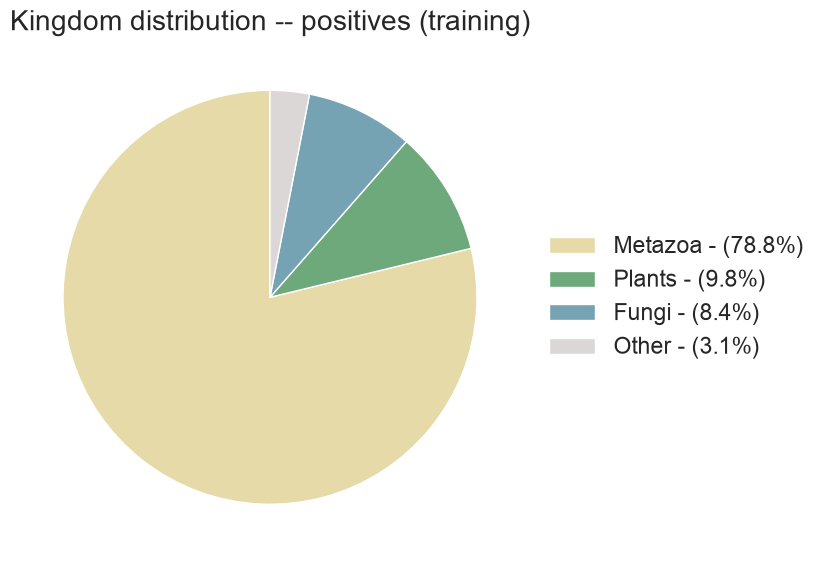 | 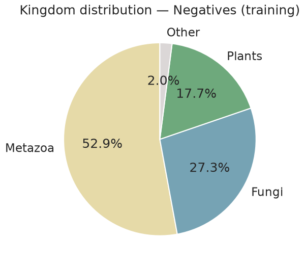 |

| Benchmark (positives) | Benchmark (negatives) |
|---|---|
| 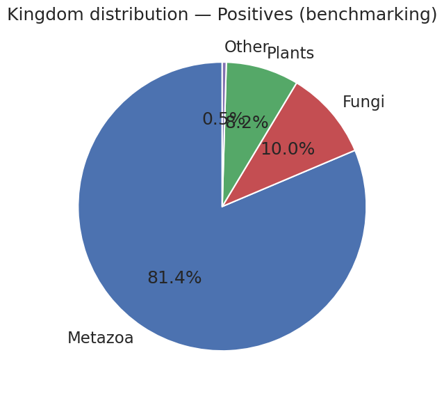 | 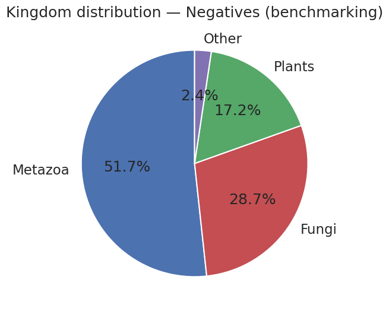 |

### Taxonomic classification ~ species
| Training (positives) | Training (negatives) |
|---|---|
| 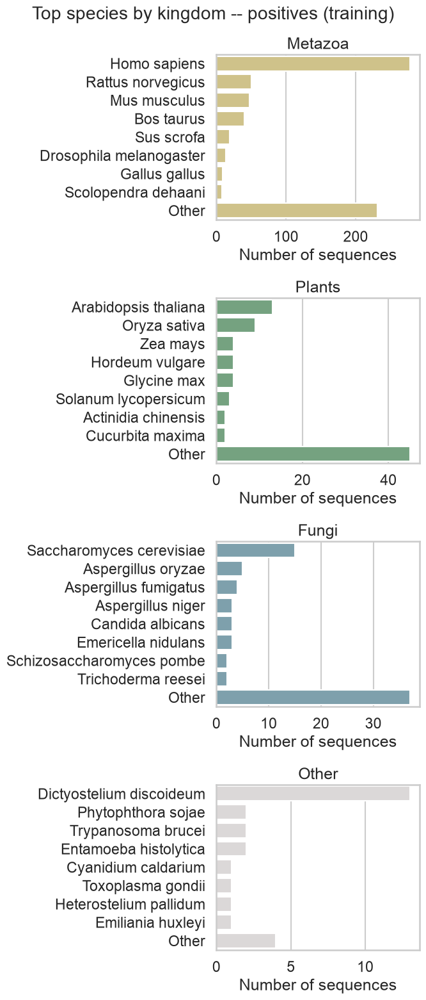 | 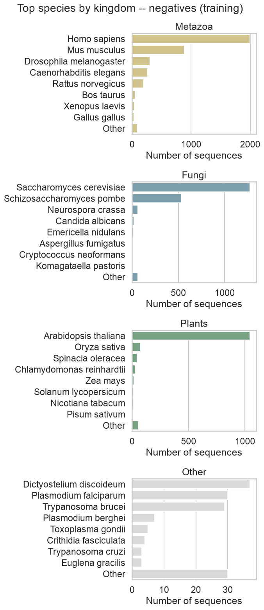 |

| Benchmark (positives) | Benchmark (negatives) |
|---|---|
| 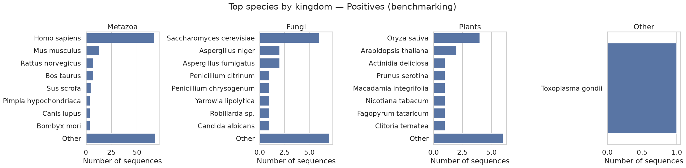 | 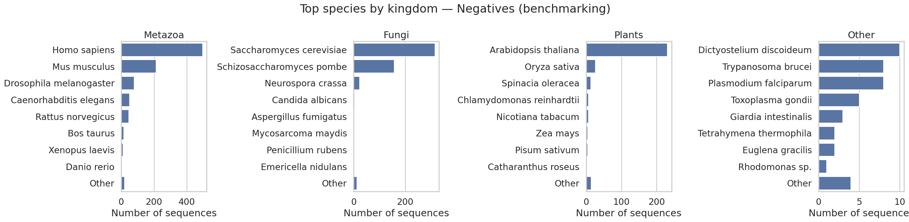 |

Code and results are in [`0.3_data_analysis/`](0.3_data_analysis/).

## von Heijne method for signal-peptide detection

The **von Heijne method** is a statistical sequence-profiling framework for detecting and discriminating signal peptide cleavage junctions in primary protein structures and modeling the amino-acid distribution around known cleavage sites.

The model is parameterized as a Position-Specific Weight Matrix (**PSWM**) estimated across a fixed asymmetric local window spanning coordinates **[-13, +2]** relative to the cleavage junction. A pseudocount of 1 is applied to positional counts. Positional emission probabilities $p_{i,a}$ across validated cleavage sites are compared against an empirical background amino acid distribution $q_a$ derived from UniProtKB/Swiss-Prot composition, yielding position-dependent log-odds weights:

$$W_{i,a} = \ln\left(\frac{p_{i,a}}{q_a}\right)$$

By sliding this scoring window across the first 90 N-terminal residues of a target sequence, the model predicts cleavage sites at the positions that achieve the highest scores.


## 5-Fold Cross-Validation Workflow

To calibrate the decision threshold and evaluate classification performance without data leakage, a 5-fold cross-validation scheme was performed. For each run (1,2,3,4,5):
- **Training (3 folds, 60%):** Cleavage contexts of positive sequences were used to build a fold-specific PSWM.
- **Validation (1 fold, 20%):** Scored with the PSWM to determine the optimal decision threshold by maximizing the $F_1$-score on the Precision-Recall curve.
- **Test (1 fold, 20%):** Evaluated strictly on unseen sequences using the calibrated threshold to compute test metrics.

### Cross-Validation Performance

The summary of test metrics across all 5 runs ($\text{mean} \pm \text{standard error}$):

| Metric | Mean ± SE |
| :--- | :---: |
| **Precision** | 0.6953 ± 0.0322 |
| **Recall** | 0.7426 ± 0.0144 |
| **Accuracy** | 0.9358 ± 0.0061 |
| **MCC** | 0.6819 ± 0.0217 |
| **F1** | 0.7163 ± 0.0194 |

### Per-Run Results

| Run | Threshold | TP | FP | TN | FN | Precision | Recall | Accuracy | MCC | F1 |
| :---: | :---: | :---: | :---: | :---: | :---: | :---: | :---: | :---: | :---: | :---: |
| **1** | 6.568 | 123 | 50 | 1404 | 54 | 0.711 | 0.695 | 0.936 | 0.667 | 0.703 |
| **2** | 5.691 | 130 | 96 | 1357 | 46 | 0.575 | 0.739 | 0.913 | 0.604 | 0.647 |
| **3** | 5.964 | 139 | 62 | 1391 | 38 | 0.692 | 0.785 | 0.939 | 0.703 | 0.735 |
| **4** | 6.576 | 132 | 42 | 1411 | 44 | 0.759 | 0.750 | 0.947 | 0.725 | 0.754 |
| **5** | 6.445 | 131 | 46 | 1407 | 45 | 0.740 | 0.744 | 0.944 | 0.711 | 0.742 |


## Final PSWM Model

Once the approach was validated, the definitive matrix (`pswm_final.tsv`) was trained on all the **positive training contexts** to reduce statistical noise for rare amino acids.
The decision threshold was set to the average threshold found across the 5 cross-validation runs:

$$\theta_{\text{final}} = \frac{6.568 + 5.691 + 5.964 + 6.576 + 6.445}{5} = \mathbf{6.2488}$$

### Final Log-Odds PSWM (Positions [-13, +2])

| Pos | A | R | N | D | C | Q | E | G | H | I | L | K | M | F | P | S | T | W | Y | V |
| :---: | :---: | :---: | :---: | :---: | :---: | :---: | :---: | :---: | :---: | :---: | :---: | :---: | :---: | :---: | :---: | :---: | :---: | :---: | :---: | :---: |
| **-13** | 0.22 | -1.96 | -3.60 | -2.29 | 0.87 | -2.47 | -2.49 | -0.82 | -1.41 | 0.12 | 1.39 | -2.16 | -0.08 | 0.84 | -1.12 | -0.31 | -0.83 | 0.41 | -1.07 | 0.53 |
| **-12** | 0.31 | -3.91 | -2.21 | -3.90 | 0.69 | -2.47 | -3.41 | -1.38 | -1.93 | 0.18 | 1.50 | -2.86 | -0.37 | 0.83 | -1.12 | -0.66 | -0.79 | 0.79 | -1.48 | 0.47 |
| **-11** | 0.21 | -2.52 | -2.50 | -3.90 | 0.97 | -1.49 | -4.10 | -0.86 | -1.64 | 0.36 | 1.38 | -3.95 | -0.19 | 0.40 | -0.87 | -0.49 | -0.41 | 0.64 | -1.48 | 0.69 |
| **-10** | 0.24 | -2.30 | -2.21 | -3.20 | 0.97 | -1.27 | -2.72 | -0.42 | -1.93 | 0.18 | 1.46 | -2.86 | -0.31 | 0.71 | -1.36 | -0.43 | -0.70 | -0.11 | -1.66 | 0.33 |
| **-9** | 0.77 | -2.81 | -1.65 | -2.11 | 0.97 | -1.78 | -2.72 | -0.42 | -1.23 | -0.31 | 1.34 | -3.96 | -0.08 | 0.49 | -1.12 | -0.05 | -0.70 | -0.22 | -1.19 | 0.17 |
| **-8** | 0.73 | -2.52 | -1.99 | -1.95 | 1.36 | -0.57 | -2.02 | -0.52 | -1.64 | -0.48 | 1.11 | -2.86 | 0.14 | 0.47 | -1.45 | 0.25 | -0.22 | 0.41 | -0.56 | 0.17 |
| **-7** | 0.35 | -1.34 | -1.30 | -2.29 | 1.28 | -0.68 | -2.16 | -0.35 | -1.64 | -0.17 | 1.25 | -1.76 | 0.10 | 0.72 | -0.67 | -0.17 | -0.19 | 0.69 | -0.71 | -0.21 |
| **-6** | 0.60 | -1.83 | -1.81 | -1.82 | 0.94 | -2.18 | -1.70 | -0.63 | -0.72 | 0.36 | 0.76 | -2.86 | -0.03 | 0.32 | 0.39 | -0.16 | -0.22 | 0.59 | -0.97 | 0.81 |
| **-5** | 0.65 | -0.73 | -0.60 | -1.01 | 0.36 | 0.24 | -0.73 | 0.53 | 0.31 | -0.98 | -0.42 | -1.18 | -0.37 | -0.66 | 0.65 | 0.60 | 0.49 | 0.00 | -0.87 | -0.21 |
| **-4** | 0.17 | -0.38 | -1.52 | -0.95 | 0.69 | -0.07 | -0.70 | 0.48 | -0.72 | -0.76 | 0.39 | -1.18 | -0.13 | -0.03 | 0.62 | 0.53 | 0.03 | 0.00 | -0.44 | 0.14 |
| **-3** | **1.20** | -2.30 | -1.52 | -2.51 | **1.57** | -2.87 | -2.31 | 0.25 | -2.33 | -0.57 | -0.88 | -2.35 | -1.29 | -2.17 | -1.56 | 0.67 | 0.56 | -1.61 | -3.27 | **1.12** |
| **-2** | 0.10 | 0.15 | -0.27 | -0.13 | -0.04 | 0.83 | 0.12 | -0.54 | 0.81 | -0.88 | 0.33 | -0.82 | -0.31 | -0.51 | -1.27 | 0.57 | -0.14 | 0.99 | -0.09 | -0.66 |
| **-1** | **1.76** | -1.20 | -1.81 | -1.95 | 0.91 | -0.93 | -2.49 | **1.09** | -2.33 | -3.28 | -2.07 | -2.01 | -1.69 | -1.94 | -0.26 | 0.58 | -0.70 | -2.30 | -1.88 | -3.02 |
| **+1** | 0.70 | -0.38 | -0.30 | 0.20 | 0.36 | 0.79 | 0.02 | -0.15 | 0.20 | -0.64 | -0.06 | -0.22 | -0.51 | -0.06 | -1.81 | 0.09 | -0.14 | 0.09 | -0.05 | -0.34 |
| **+2** | -0.57 | 0.06 | -0.10 | 0.20 | 0.36 | 0.22 | 0.37 | -0.19 | 0.07 | -0.64 | -0.75 | -0.17 | -1.69 | -0.37 | **1.09** | 0.41 | 0.01 | -0.36 | -0.05 | -0.25 |

Code and results are in [`0.4_Von_Heijne/`](0.4_Von_Heijne/).


## SVM method for signal-peptide detection

The SVM method represents each protein as a vector of features computed on its N-terminal region and classifies it with a Support Vector Machine. Unlike the von Heijne matrix, which scores only a local window around the cleavage site, the SVM exploits global properties of the whole N-terminus.

```
sequences → features → Random Forest ranking (top-k) → standardization → RBF SVM (C, γ)
```

### Feature extraction (D = 24)

Each protein is encoded by 24 features computed on its N-terminal region: the amino-acid composition of the first *n* residues, three hydrophobicity features and the charge of the n-region.

| Feature | Count | Biological rationale |
| :--- | :---: | :--- |
| Amino-acid composition of the first *n* residues | 20 | SPs are enriched in non-polar residues (L, A, V) and depleted in charged ones |
| Maximum Kyte-Doolittle hydrophobicity | 1 | hydrophobic h-region of the SP |
| Mean Kyte-Doolittle hydrophobicity | 1 | overall hydrophobicity of the N-terminus |
| Position of the hydrophobicity maximum | 1 | the SP h-region peaks around residues 10–15, a transmembrane helix further downstream |
| Net charge of the n-region | 1 | the SP n-region is positively charged |

The composition length *n* is not fixed a priori: it is the median SP length of the current training set, recomputed at every level of the cross-validation; the composition vector sums to 1. Hydrophobicity is computed on the first 40 residues with a sliding window of 5 residues; the n-region charge on the first 5 residues (K, R = +1; D, E = −1). The last two features were added a priori, motivated by the SP architecture (n-region → h-region → c-region), to separate SPs from transmembrane helices, which are hydrophobic as well. They were defined before looking at the cross-validation results and evaluated once.

- **Feature selection:** a Random Forest (500 trees, fixed random state) ranks the features by importance on each training set; only the top-*k* features are passed to the SVM.
- **Classifier:** an SVM with RBF kernel, trained on standardized features. C controls the penalty for training errors, γ the width of the Gaussian kernel.


## Nested Cross-Validation Workflow

To select the hyper-parameters and evaluate performance without data leakage, a nested cross-validation was performed on the 5 predefined subsets, without reshuffling:
- **Outer loop (evaluation):** each subset is used once as test set; the other 4 form the training set.
- **Inner loop (model selection):** a 4-fold cross-validation on the 4 training subsets selects *k*, C and γ by the highest mean validation MCC.
- **Test:** the model is refitted on the 4 training subsets with the selected values, recomputing *n* and the feature ranking, and evaluated once on the test subset.

Every component (*n*, Random Forest ranking, scaler, SVM) is fitted on training data only.

**Grid search.** The minimal grid set at first run is *k* ∈ {D/4, D/2, D}, C ∈ {1, 4, 16} and γ ∈ {0.5/k, 1/k, 2/k}, with *k* ∈ {6, 12, 24} for D = 24. On the D = 22 pipeline, the best values fell on the lower edge of the minimal grid in all five outer runs, so the C and γ grids were extended twice. The final grid is:
- C ∈ {0.25, 0.5, 1, 4, 16, 64}
- γ ∈ {0.0625/k, 0.125/k, 0.25/k, 0.5/k, 1/k, 2/k}

With it, no outer run of the final D = 24 pipeline selects a value on the edge (in the D = 22 ablation only run 1 does, γ = 0.0625/k). The optimum is flat along the C–γ diagonal, where a larger C is compensated by a smaller γ: in run 1 of the D = 24 pipeline, the best combination (C = 16, γ = 0.125/k, mean inner MCC 0.8124) is practically tied with C = 1, γ = 1/k (0.8119). Further extension of the grid was therefore not pursued.

### Cross-Validation Performance

The summary of test metrics across the 5 outer runs ($\text{mean} \pm \text{standard error}$), compared with the von Heijne method. D = 22 is an ablation of the same pipeline without the two structural features, evaluated on the same folds with the same final grid.

| Metric | von Heijne | SVM, D = 22 | SVM, D = 24 |
| :--- | :---: | :---: | :---: |
| **Precision** | 0.6953 ± 0.0322 | 0.8192 ± 0.0153 | **0.8366 ± 0.0137** |
| **Recall** | 0.7426 ± 0.0144 | 0.8061 ± 0.0130 | **0.8198 ± 0.0106** |
| **Accuracy** | 0.9358 ± 0.0061 | 0.9595 ± 0.0010 | **0.9631 ± 0.0021** |
| **MCC** | 0.6819 ± 0.0217 | 0.7896 ± 0.0036 | **0.8074 ± 0.0105** |
| **F1** | 0.7163 ± 0.0194 | 0.8117 ± 0.0029 | **0.8278 ± 0.0092** |

### Per-Run Results (D = 24)

| Run | Test subset | n | k | C | γ | TP | FP | TN | FN | Precision | Recall | Accuracy | MCC | F1 |
| :---: | :---: | :---: | :---: | :---: | :---: | :---: | :---: | :---: | :---: | :---: | :---: | :---: | :---: | :---: |
| **1** | 0 | 22 | 24 | 16 | 0.125/k | 139 | 31 | 1423 | 38 | 0.8176 | 0.7853 | 0.9577 | 0.7777 | 0.8012 |
| **2** | 1 | 22 | 24 | 1 | 1/k | 149 | 31 | 1422 | 27 | 0.8278 | 0.8466 | 0.9644 | 0.8172 | 0.8371 |
| **3** | 2 | 22 | 24 | 4 | 0.5/k | 143 | 26 | 1427 | 34 | 0.8462 | 0.8079 | 0.9632 | 0.8063 | 0.8266 |
| **4** | 3 | 22 | 24 | 1 | 1/k | 146 | 35 | 1418 | 30 | 0.8066 | 0.8295 | 0.9601 | 0.7956 | 0.8179 |
| **5** | 4 | 22 | 24 | 1 | 1/k | 146 | 19 | 1434 | 30 | 0.8848 | 0.8295 | 0.9699 | 0.8401 | 0.8563 |

### Per-Run Results (D = 22, ablation)

| Run | Test subset | n | k | C | γ | TP | FP | TN | FN | Precision | Recall | Accuracy | MCC | F1 |
| :---: | :---: | :---: | :---: | :---: | :---: | :---: | :---: | :---: | :---: | :---: | :---: | :---: | :---: | :---: |
| **1** | 0 | 22 | 22 | 16 | 0.0625/k | 144 | 37 | 1417 | 33 | 0.7956 | 0.8136 | 0.9571 | 0.7804 | 0.8045 |
| **2** | 1 | 22 | 22 | 1 | 1/k | 148 | 37 | 1416 | 28 | 0.8000 | 0.8409 | 0.9601 | 0.7978 | 0.8199 |
| **3** | 2 | 22 | 22 | 1 | 0.5/k | 138 | 24 | 1429 | 39 | 0.8519 | 0.7797 | 0.9613 | 0.7936 | 0.8142 |
| **4** | 3 | 22 | 22 | 1 | 0.25/k | 145 | 39 | 1414 | 31 | 0.7880 | 0.8239 | 0.9570 | 0.7817 | 0.8056 |
| **5** | 4 | 22 | 22 | 4 | 0.5/k | 136 | 22 | 1431 | 40 | 0.8608 | 0.7727 | 0.9619 | 0.7947 | 0.8144 |

### Effect of the Structural Features

Paired comparison of the test MCC on the same folds:

| Run | MCC, D = 22 | MCC, D = 24 | Difference |
| :---: | :---: | :---: | :---: |
| **1** | 0.7804 | 0.7777 | −0.0027 |
| **2** | 0.7978 | 0.8172 | +0.0194 |
| **3** | 0.7936 | 0.8063 | +0.0127 |
| **4** | 0.7817 | 0.7956 | +0.0139 |
| **5** | 0.7947 | 0.8401 | +0.0454 |


## Final SVM Model

Once the approach was validated, the definitive model (`D24_svm_final_model.pkl.gz`) was trained on the **whole training set**, with hyper-parameters chosen by cross-validation on all 5 subsets: *n* = 22, *k* = 24, C = 1, γ = 1/k; all 24 features are retained. The D = 24 model was selected as the final model before the benchmark evaluation, so that the benchmark remains an unbiased estimate of its performance.

Code and results are in [`0.5_feature_selection_svm/`](0.5_feature_selection_svm/).
